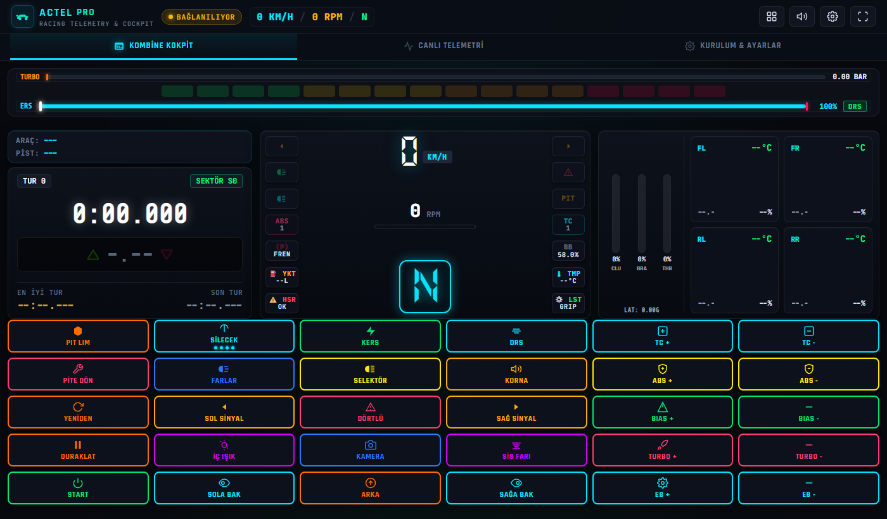
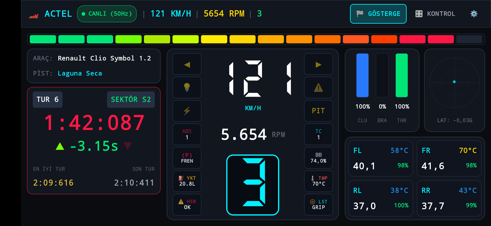
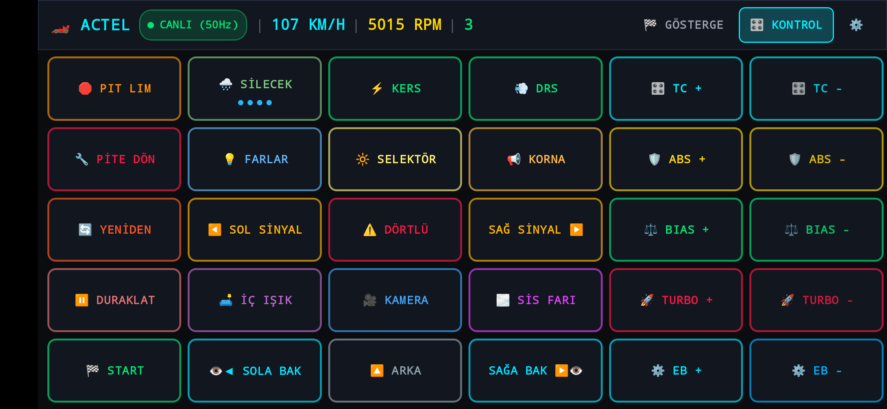
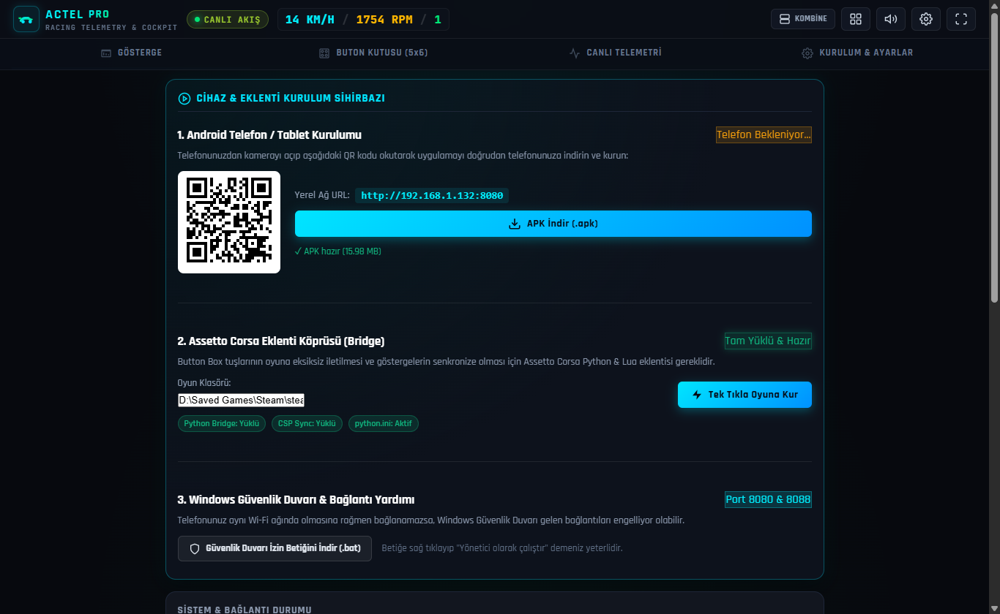

# 🏎️ ACTel - Assetto Corsa Telemetry & Control Cockpit

[](https://github.com/FatihEsen/actel/releases)
[](https://kotlinlang.org/)
[](https://developer.android.com/jetpack/compose)
[](https://nodejs.org/)
[](https://github.com/FatihEsen/actel/releases)
[](https://assettocorsa.gg/)
[](LICENSE)

**ACTel**, Assetto Corsa yarış simülasyonu için özel olarak tasarlanmış; ultra düşük gecikmeli (50Hz), donanım hızlandırmalı ve çift yönlü senkronizasyona sahip profesyonel bir **Masaüstü/Web Kombine Kokpit**, **Native Android Telemetri Göstergesi (Dashboard)** ve **Dokunsal Düğme Kutusu (Button Box)** ekosistemidir.

Sidekick telemetri eklentisiyle birebir matematiksel pariteye sahip algoritmaları, sıfır kaydırma (zero-scroll) gerektiren kompakt arayüzü ve yerel ağ QR kod eşleştirmesi ile yarış simülasyonunuzu gerçek bir motor sporları kokpitine dönüştürür.

---

## 📸 Ekran Görüntüleri (Screenshots)

### 1. Masaüstü & Web Kombine Kokpit (Combined Cockpit)
Tek ekranda sıfır dikey kaydırma (zero-scroll) ile çalışan birleşik yarış kokpiti. Üst panelde 16 LED dinamik FIA Shift Light devir barı, Sidekick Turbo ve ERS/KERS güç barları, otantik 7-segment dijital vites, büyütülmüş hız/devir göstergesi, 7+7 simetrik kokpit kanatları (Sol: Sinyal, Far, Flaşör, ABS, Fren Dağılımı, Yakıt, Hasar / Sağ: Sinyal, Dörtlü, PIT, TC, Fren Denge, Pist Sıcaklığı, Lastik Kayma), kompakt debriyaj/fren/gaz pedalları, G-Kuvveti dairesi ve 4 tekerlek lastik telemetrisi (PSI, pratik sıcaklık ve aşınma yüzdesi). Alt panelde ise 30 butonlu CNC dokunsal buton kutusu yer alır.



### 2. Mobil Canlı Yarış Göstergesi (Android Dashboard)
**Kotlin & Jetpack Compose** ile 60/120Hz donanım hızlandırmalı native mobil gösterge. Otantik yarış tipografisi, vites geçiş ışıkları, gerçek zamanlı Sidekick spline ghost delta farkı, ikinci mertebe trend okları ve kesintisiz devir kesici / kerb darbe haptik titreşim geri bildirimi. Pencereler arasında parmakla kaydırarak (Horizontal Swipe) pürüzsüz geçiş yapılabilir.



### 3. Mobil Dokunsal Sanal Buton Kutusu (Android 5x6 Button Box)
Tam ekran 5x6 (30 buton) dokunsal buton matrisi, üst anlık telemetri durum şeridi, soldan sağa sırayla yanan 4 kademeli LED silecek butonu, bas-çek anlık KERS/DRS tetikleyicileri ve oyunun telemetrisiyle çift yönlü teyitli çalışan aydınlatma / sinyal göstergeleri.



### 4. Kurulum, Ayarlar & QR Kod Eşleştirme (Settings)
Sıfır yapılandırmalı yerel ağ PC radar keşfi (Zero-Config UDP radar), telefondan veya tabletten kamerayı açıp anında bağlanmayı sağlayan yerel ağ QR kodu, tek tıkla Assetto Corsa Python köprü eklentisi (`actel_bridge`) kurulum sihirbazı, titreşim şiddeti kaydırıcısı (%20 - %100) ve çalışma modu seçici (AUTO / LIVE / DEMO).



---

## 🌟 Temel Özellikler

### 🖥️ 1. Masaüstü & Web Kombine Kokpit
* **Zero-Scroll Entegre Tasarım**: 1366x768 ve üzeri tüm ekran çözünürlüklerinde dikey kaydırmaya ihtiyaç duymadan telemetri paneli ve 30 butonlu kontrol konsolunu tek ekranda sunar.
* **16 LED FIA Kademeli Devir Işıkları (Shift Lights)**: Aracın devir aralığına ve ideal vites yükseltme noktasına göre yeşil, sarı, turuncu ve kırmızı kademelerle dinamik yanar.
* **Sidekick Matematiksel Paritesi**:
  * **Pratik Lastik Sıcaklığı Formülü**: Yanıltıcı çekirdek sıcaklığı yerine lastiğin gerçek tutunma durumunu yansıtan ağırlıklı sıcaklık hesaplaması:  
    $$\text{tempPractical} = 0.25 \times \left(\frac{T_I + T_M + T_O}{3}\right) + 0.75 \times T_{\text{core}}$$
  * **Out-Lap & Pit Alanı Delta Baskılama**: Çıkış turlarında (`completedLaps == 0`) veya pitteyken hayalet delta (`-.--`) ve trend okları geçersiz kılınarak kafa karışıklığı önlenir.
  * **İkinci Mertebe Ghost Trend Filtresi**: 100ms aralıklarla hesaplanan ikinci mertebe fark formülü ($\text{trend} = 2 \times \Delta - \Delta_{t-1} - \Delta_{t-2}$) ile anlık zaman kazancı/kaybı doğru filtrelenir.
  * **2. Tur Monotonik Ghost Düzeltmesi**: Sidekick `poslist`/`timelist` dosyalarındaki wrap hataları arındırılarak yeni oturumlarda da 2. turdan itibaren kararlı ghost deltası üretilir.
* **Çift Anlamlı Semantik Renkler**: Delta zamanı rengi mutlak önde/geride durumunu gösterirken, trend okları o anki virajdaki anlık zaman değişimini belirtir.

### 🎛️ 2. Çift Yönlü Buton Kutusu (5x6 Matris - 30 Buton)
* **Otoriter Oyun Durumu Doğrulaması**: Farlar, sinyaller ve flaşörler istemci tarafındaki tahminlerle değil, oyunun paylaşılan belleğinden (`graphics.lightsStage` vb.) teyit edilerek buton renkleriyle senkronize edilir.
* **4 Kademeli LED Silecek Butonu**: Her basışta soldan sağa sırayla yanan (Kapalı -> Kademe 1 -> Kademe 2 -> Kademe 3 -> Kademe 4) 4 LED göstergeli modern buton tasarımı.
* **ABS & TC Kademe Otomasyonu**: Araç yüklenirken aracın `.ini` dosyalarından kaç kademe ABS/TC desteklediği taranır ve gösterge ile buton adımları otomatik eşzamanlanır.
* **Bas-Çek Hibrit Eylemler**: KERS ve DRS tuşları dokunulduğunda basılı kalır, el çekildiğinde serbest bırakılır.

### 📱 3. Native Android Uygulaması (Kotlin + Jetpack Compose)
* **Donanım Hızlandırmalı Render (60 / 120Hz)**: Minimum pil tüketimi ve gecikmesiz akıcı arayüz.
* **Gelişmiş Haptik Titreşim Motoru**:
  * **Kesintisiz Devir Kesici (Redline)**: Devir kesicide ritmik kesici vibrasyonu.
  * **Bordür, Kasis & Çarpışma Titreşimi**: Kerb geçişlerinde ve zemin dalgalanmalarında süspansiyon ivmesine bağlı dinamik dokunsal titreşim.
  * **Titreşim Gücü Ayarı**: %20 ile %100 arasında ayarlanabilir haptik geri bildirim.
* **Sıfır Yapılandırmalı UDP Beacon**: Aynı Wi-Fi ağına bağlanıldığında PC sunucusunu 1 saniyede otomatik bulur.

### 🚀 4. Windows Bağımsız Taşınabilir Sürüm (`ACTel.exe`)
* **Kurulumsuz Tek Tıkla Başlatma**: Arka planda Node.js sunucusunu otomatik başlatır, 8080 portundaki çakışmaları temizler ve sistem tepsisine (Tray Icon) yerleşir.
* **Frameless PWA Pencere Modu**: Tarayıcı adres çubuğu veya sekmeleri olmadan yerel bir Windows uygulaması gibi çalışır.

---

## 🎮 Buton Kutusu Eşleşmeleri (Keybindings)

Tüm tuş eşleşmeleri **orijinal Assetto Corsa ve Custom Shaders Patch (CSP)** fabrika varsayılanlarına göre önceden ayarlanmıştır:

| Sıra / Sütun | Buton Etiketi | İşlev | Gönderilen Varsayılan Tuş / Eylem |
| :---: | :--- | :--- | :--- |
| **R1-C1** | `🛑 PIT LIM` | Pit Hız Sınırlayıcı Aç/Kapat | `Alt + L` (CSP Pit Limiter Standardı) |
| **R1-C2** | `🌧️ SİLECEK` | 4 Kademeli Cam Sileceği | `Alt + W` (CSP Standardı) |
| **R1-C3** | `⚡ KERS` | Hibrit / MGU-K Güç Boşaltma | `K` (Orijinal AC Varsayılanı - Bas-Çek) |
| **R1-C4** | `💨 DRS` | Arka Kanat DRS Aç/Kapat | `D` (Orijinal AC Varsayılanı - Bas-Çek) |
| **R1-C5** | `🎛️ TC +` | Çekiş Kontrolü Artır | `Ctrl + T` (Orijinal AC Varsayılanı) |
| **R1-C6** | `🎛️ TC -` | Çekiş Kontrolü Azalt | `Ctrl + Shift + T` (Orijinal AC Varsayılanı) |
| **R2-C1** | `🔧 PİTE DÖN` | Aracı Pite Işınla / Teleport | `Ctrl + P` (Orijinal AC / CM Varsayılanı) |
| **R2-C2** | `💡 FARLAR` | Far Aç / Kapat | `L` (Orijinal AC Varsayılanı - Canlı Senkron) |
| **R2-C3** | `🔆 SELEKTÖR` | Flaşör / Selektör Yak | `G` (Orijinal AC Varsayılanı) |
| **R2-C4** | `📢 KORNA` | Korna Çal | `H` (Orijinal AC Varsayılanı) |
| **R2-C5** | `🛡️ ABS +` | ABS Seviyesi Artır | `Ctrl + A` (Orijinal AC Varsayılanı) |
| **R2-C6** | `🛡️ ABS -` | ABS Seviyesi Azalt | `Ctrl + Shift + A` (Orijinal AC Varsayılanı) |
| **R3-C1** | `🔄 YENİDEN` | Oturumu Baştan Başlat | `Ctrl + O` (Orijinal AC / CM Varsayılanı) |
| **R3-C2** | `◀️ SOL SİNYAL` | Sol Dönüş Sinyali | `Alt + Sol Ok` (CSP Standardı) |
| **R3-C3** | `⚠️ DÖRTLÜ` | Dörtlü Flaşörler (Hazard) | `Alt + Aşağı Ok` (CSP Standardı) |
| **R3-C4** | `SAĞ SİNYAL ▶️`| Sağ Dönüş Sinyali | `Alt + Sağ Ok` (CSP Standardı) |
| **R3-C5** | `⚖️ BIAS +` | Fren Dağılımını Öne Ver | `Ctrl + B` (Orijinal AC Varsayılanı) |
| **R3-C6** | `⚖️ BIAS -` | Fren Dağılımını Arkaya Ver | `Ctrl + Shift + B` (Orijinal AC Varsayılanı) |
| **R4-C1** | `⏸️ DURAKLAT` | Oyunu Duraklat / Menüyü Aç | `ESC` (Orijinal AC Varsayılanı) |
| **R4-C2** | `🛋️ İÇ IŞIK` | Kabin Aydınlatması (Extra A) | `Alt + Numpad 7` (CSP Standardı) |
| **R4-C3** | `🎥 KAMERA` | Sürüş Kamerası Değiştir | `F1` / `C` (Orijinal AC Varsayılanı) |
| **R4-C4** | `🌫️ SİS FARI` | Sis Farı / Uzunlar (Extra B) | `Alt + Numpad 8` (CSP Standardı) |
| **R4-C5** | `🚀 TURBO +` | Turbo Basıncını Artır | `1` ... `0` Rakam Tuşları |
| **R4-C6** | `🚀 TURBO -` | Turbo Basıncını Azalt | `1` ... `0` Rakam Tuşları |
| **R5-C1** | `🏁 START` | Content Manager Başlat / Marş | `Ctrl + S` + `ESC` + `Space` + `I` |
| **R5-C2** | `👁️◀ SOLA BAK`| Sola Bakış Açısı | `Q` (Orijinal AC Varsayılanı) |
| **R5-C3** | `🔼 ARKA` | Arkaya Bakış Açısı | `W` (Orijinal AC Varsayılanı) |
| **R5-C4** | `SAĞA BAK ▶️👁️`| Sağa Bakış Açısı | `E` (Orijinal AC Varsayılanı) |
| **R5-C5** | `⚙️ EB +` | Motor Freni (Engine Brake) + | `Ctrl + E` |
| **R5-C6** | `⚙️ EB -` | Motor Freni (Engine Brake) - | `Ctrl + Shift + E` |

---

## 🚀 Hızlı Başlangıç & Kurulum

### 1. Gereksinimler
* **PC**: Windows 10/11, Assetto Corsa (Custom Shaders Patch tavsiye edilir).
* **Mobil (İsteğe Bağlı)**: Android 8.0 veya üzeri telefon ya da tablet.

### 2. PC Kurulumu (İki Farklı Yöntem)

#### Yöntem A: Taşınabilir Windows Paketi (En Pratik)
1. [Releases](https://github.com/FatihEsen/actel/releases) sayfasından `ACTel-v1.0.0-windows-x64.zip` dosyasını indirin ve bir klasöre çıkartın.
2. Klasör içerisindeki **`ACTel.exe`** dosyasına çift tıklayın.
3. Kokpit penceresi otomatik olarak açılır ve arka plan servisleri başlatılır.

#### Yöntem B: Kaynak Koddan Çalıştırma (Geliştirici)
```cmd
git clone https://github.com/FatihEsen/actel.git
cd actel
npm install
npm start
```

### 3. Mobil Cihaz Bağlantısı
1. [Releases](https://github.com/FatihEsen/actel/releases) sayfasından `app-debug.apk` dosyasını telefonunuza yükleyin.
2. PC ile telefonunuzun aynı Wi-Fi ağına bağlı olduğundan emin olun.
3. Uygulamayı açtığınızda PC sunucusu otomatik keşfedilecektir.
4. İsteğe bağlı olarak masaüstü kokpitindeki **QR Kod** simgesine tıklayarak telefon kamerasıyla tarayıcı üzerinden de anında bağlanabilirsiniz.

#### ⚡ Kablolu USB Bağlantısı (Sıfır Gecikme)
Wi-Fi olmayan ortamlarda telefonunuzu USB ile bağlayıp şu komutu çalıştırabilirsiniz:
```cmd
adb reverse tcp:8080 tcp:8080
```

---

## 📁 Proje Mimarisi

```
actel/
├── server.js                        # HTTP, WebSocket & UDP Beacon telemetri sunucusu
├── package.json                     # Bağımlılıklar ve derleme scriptleri
├── .gitignore                       # Git kuralları
├── AGENTS.md                        # Telemetri parite ve kontrol kılavuzu
│
├── docs/
│   └── screenshots/                 # Güncel kokpit ve mobil ekran görüntüleri
│       ├── combined_cockpit.png     # Masaüstü/Web Kombine Kokpit (Zero-scroll)
│       ├── mobile_dashboard.png     # Native Android yarış göstergesi
│       ├── mobile_buttonbox.png     # Android 5x6 dokunsal buton kutusu
│       └── settings.png             # Kurulum sihirbazı & QR eşleştirme
│
├── public/                          # Web & Masaüstü Kombine Arayüz
│   ├── index.html                   # Entegre kokpit ve konsol HTML yapısı
│   ├── css/style.css                # Motorsport UI, FIA LED ve CNC buton stilleri
│   ├── fonts/                       # 7-Segment dijital yarış fontları
│   └── js/
│       ├── app.js                   # Uygulama durumu, sekmeler ve QR yönetimi
│       ├── dashboard.js             # 50Hz telemetri render motoru & Sidekick paritesi
│       ├── buttonbox.js             # 30 butonlu matris, 4 noktalı silecek ve haptik
│       └── tyres.js                 # 4 tekerlek pratik sıcaklık ve aşınma hesaplayıcı
│
├── lib/                             # Sunucu Katmanı ve AC Entegrasyonu
│   ├── acReader.js                  # Shared Memory (physics, graphics, static) okuyucu
│   ├── acController.js              # Windows API klavye simülasyonu & durum takibi
│   ├── ghostTracker.js              # Spline pozisyonu, 2. tur monotonik filtre & delta
│   ├── networkHelper.js             # Yerel IP keşfi ve QR SVG oluşturucu
│   ├── carInfoReader.js             # Araç .ini limiter, devir ve kademe tespiti
│   └── mockTelemetry.js             # Simülasyon telemetri üreteci (Demo modu)
│
├── src/launcher/
│   └── ACTelLauncher.cs             # C# sistem tepsisi & frameless masaüstü başlatıcı
│
├── ac_plugin/                       # Assetto Corsa Python Köprüsü
│   └── actel_bridge/                # AC içi telemetri ve komut köprüsü
│
└── android/                         # Native Jetpack Compose Mobil Uygulaması
    └── app/src/main/java/com/actel/dashboard/
        ├── MainActivity.kt          # Tam ekran, haptik titreşim ve çarpışma motoru
        ├── ui/screens/
        │   ├── DashboardScreen.kt   # Canlı telemetri, kanatlar ve vites göstergesi
        │   ├── ButtonBoxScreen.kt   # 5x6 dokunsal buton kutusu & 4 LED silecek
        │   └── SettingsScreen.kt    # Ağ durumu, radar ve titreşim ayarları
        └── viewmodel/MainViewModel.kt # StateFlow telemetri akışı
```

---

## 📄 Lisans

Bu proje [MIT Lisansı](LICENSE) kapsamında açık kaynak olarak lisanslanmıştır. Dilediğiniz gibi geliştirebilir, modifiye edebilir ve kullanabilirsiniz.
