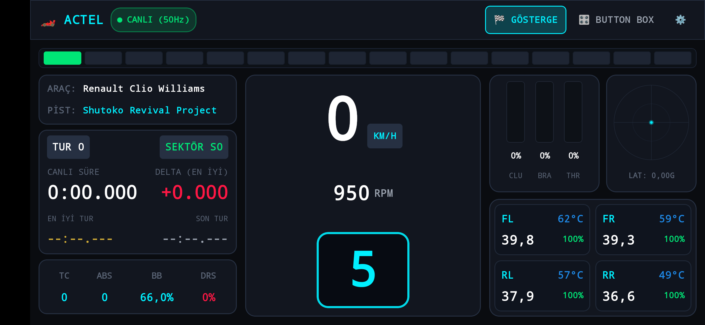
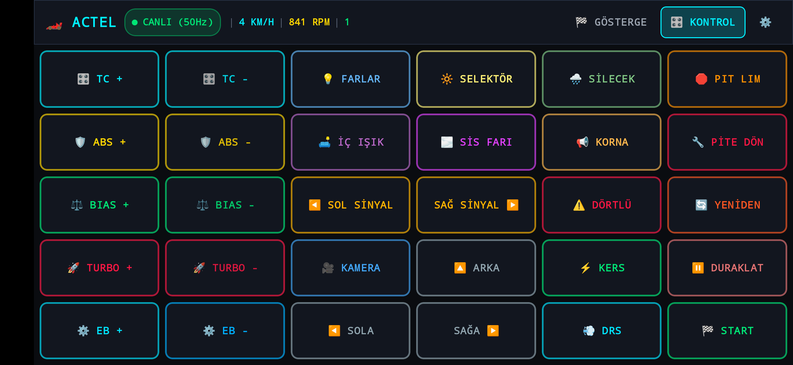
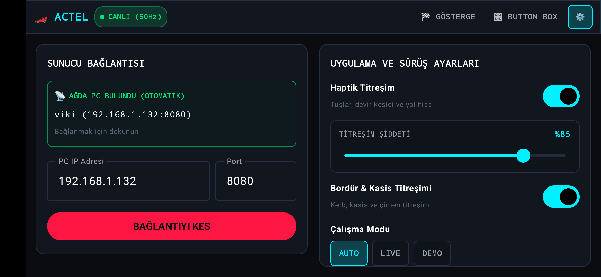

# 🏎️ ACTel - Assetto Corsa Telemetry & Button Box System

[](https://github.com/FatihEsen/actel/releases)
[](https://nodejs.org/)
[](https://kotlinlang.org/)
[](https://developer.android.com/jetpack/compose)
[](https://assettocorsa.gg/)
[](LICENSE)

**ACTel**, Assetto Corsa yarış simülasyonu için özel olarak geliştirilmiş; ultra düşük gecikmeli (50Hz), donanım hızlandırmalı ve haptik titreşim geri bildirimli profesyonel bir **Telemetri Göstergesi (Dashboard)** ve **Sanal Düğme Kutusu (Button Box)** ekosistemidir.

Hem **Native Android (Kotlin + Jetpack Compose)** hem de **Modern Web Arayüzü (HTML5 / Vanilla CSS / ES6)** olarak çalışır.

---

## 📸 Ekran Görüntüleri (Screenshots)

### 1. Canlı Yarış Göstergesi (Dashboard)
16 LED kademeli Shift Light devir barı, büyük çerçeveli dijital vites göstergesi, hız (KM/H), canlı tur zamanı ve delta farkı, debriyaj / fren / gaz pedalları, 2D G-Kuvveti dairesi, anlık DRS & Batarya doluluğu ve 4 tekerlek lastik telemetrisi (PSI, °C ve aşınma).



### 2. Sanal Buton Kutusu (Button Box)
Oyun odaktan çıkmadan araç ve oturum kontrolleri: TC, ABS, Fren Dağılımı, Farlar, Selektör, Silecek, Korna, Content Manager Start (`Ctrl+S`), Duraklat (`ESC`), Pit Limiter, DRS, Sinyaller, Dörtlü Flaşör ve Kamera / Bakış açıları.



### 3. Ayarlar & Haptik Titreşim Kontrolü (Settings)
Otomatik yerel ağ PC keşfi (Zero-Config UDP radar), kesintisiz devir kesici titreşim şiddeti slider'ı (%20 - %100), bordür / kasis / zemin titreşim anahtarı ve çalışma modları (AUTO / LIVE / DEMO).



---

## 📦 Hazır APK İndirme (GitHub Releases)

Derleme yapmadan doğrudan kullanmak için:
1. Sağ taraftaki **[Releases](https://github.com/FatihEsen/actel/releases)** bölümünden en güncel `app-debug.apk` dosyasını telefonunuza indirin.
2. Telefonunuzda APK dosyasını açıp kurulumu onaylayın.
3. PC sunucusunu başlattıktan sonra uygulamayı açtığınızda telefon PC'yi otomatik keşfedip bağlanacaktır.

---

## 🌟 Temel Özellikler

### 📱 1. Native Android Uygulaması (Kotlin + Jetpack Compose)
* **60 / 120Hz Donanım Hızlandırma**: Kusursuz akıcılıkta yarış arayüzü.
* **Gelişmiş Haptik Titreşim Motoru**:
  * **Kesintisiz Devir Kesici (Redline)**: Araç son %5'lik devir dilimine (`rpms >= maxRpm * 0.95`) girdiğinde sürücü vites yükseltene kadar ritmik kesici hissiyle titrer.
  * **Çarpışma & Darbe Titreşimi**: Kaza veya sert bordür/bariyer çarpmalarında telefonun vibratörü güçlü darbe ritmiyle anlık uyarır.
  * **Titreşim Şiddeti Kaydırıcısı (Slider)**: %20 ile %100 arasında ayarlanabilir, kaydırıldığında anlık dokunsal geri bildirim önizlemesi verir.
  * **Bordür (Kerb), Kasis ve Zemin Titreşimi**: Süspansiyon darbe ivmesi ve dikey G kuvveti hesaplanarak kerblerde ve çakılda direksiyon/yol titreşimi simüle edilir.
* **Yarış Modu Ekran Yönetimi**:
  * `FLAG_KEEP_SCREEN_ON`: Yarış esnasında ekran asla kararmaz / kapanmaz.
  * `Immersive Fullscreen`: Sistem gezinti çubukları gizlenir, tam ekran çalışır.
* **Sıfır Yapılandırmalı Otomatik Bağlantı (UDP Beacon)**: PC IP adresini elle girmeye gerek kalmadan yerel ağdaki Assetto Corsa sunucusunu 1 saniyede otomatik bulur.

### 🌐 2. Modern Web Arayüzü (Mobil & Masaüstü Uyumlu)
* **3 Sütunlu Kokpit Mimarisi**: Web arayüzü Android mobil arayüzü ile birebir aynı estetik ve yerleşimdedir.
* **Dijital Vites Kutusu**: Motec / Bosch göstergelerindeki gibi dijital LCD segment fontu ve neon parıltı.
* **DRS & Batarya Doluluk Göstergesi**: Sol altta batarya doluluğu yüzde (`%XX`) olarak gösterilir. DRS kullanılabilir bölgelerde **Yeşil**, kullanılamayan yerlerde **Kırmızı** renge bürünür.
* **Start & Yeniden Başlat Sonrası 1sn Otomatik Gösterge**: Start veya Yeniden Başlat butonuna basıldıktan 1 saniye sonra ekran otomatik olarak Gösterge (`Dashboard`) sekmesine döner.
* **Görsel Çarpışma Efekti**: Çarpışmalarda ekran sarsıntısı ve kırmızı darbe parlaması gerçekleşir. Tarayıcı üzerinden Gamepad rumble desteği mevcuttur.
* **Mobil Tarayıcı Desteği & QR Kod**: PC arayüzündeki QR kodu telefonunuzla okutarak herhangi bir uygulama yüklemeden de tarayıcı üzerinden göstergeyi kullanabilirsiniz.

### 🖥️ 3. PC Telemetri & Kontrol Sunucusu (Node.js)
* **Sıfır Gecikmeli Shared Memory**: Windows `kernel32.dll` API'si üzerinden Assetto Corsa'nın paylaşılan bellek sayfalarını (`acpmf_physics`, `acpmf_graphics`, `acpmf_static`) C-struct hızında doğrudan okur.
* **Araca Özel Dinamik Veri Okuma**: Aracın `.ini` dosyalarını (`car.ini`, `engine.ini`) tarayarak doğru devir kesici (limiter) ve ideal vites yükseltme (shift light) devirlerini otomatik tespit eder.
* **Content Manager & CSP Entegrasyonu**: Mobil arayüzden gönderilen eylemleri oyunun pencere odağını bozmadan Windows API (`keybd_event`) ve Custom Shaders Patch üzerinden simülasyona aktarır.
* **Akıllı Mod Yönetimi (AUTO / LIVE / DEMO)**: Oyun açık olmadığında otomatik olarak gerçekçi simüle telemetri üretir, oyun başladığında anında canlı moda geçer.

---

## 🎮 Buton Kutusu Eşleşmeleri (Keybindings)

| Buton | İşlev | Gönderilen Tuş / Eylem |
| :--- | :--- | :--- |
| **START** | Content Manager Yarışı Başlat / Menüden Çık / Marş | `Ctrl + S` (CSP Start) + `ESC` + `Space` + `I` (Marş) *(1sn sonra Dashboard'a döner)* |
| **DURAKLAT** | Oyunu Duraklat / Menüyü Aç | `ESC` |
| **TC + / -** | Çekiş Kontrolü Seviyesi | `Ctrl + T` / `Ctrl + Shift + T` |
| **ABS + / -** | Kilitlenme Karşıtı Fren Seviyesi | `Ctrl + A` / `Ctrl + Shift + A` |
| **BIAS + / -** | Fren Ön/Arka Denge Dağılımı | `Ctrl + B` / `Ctrl + Shift + B` |
| **PIT LIMITER**| Pit Hız Sınırlayıcı Aç/Kapat | `Ctrl + L` |
| **DRS** | Arka Kanat DRS Aç/Kapat | `D` |
| **FARLAR** | Far Aç / Kapat | `L` |
| **SELEKTÖR** | Flaşör / Selektör Yak | `F` |
| **SİLECEK** | Cam Sileceği Aç / Hız Değiştir | `Alt + W` |
| **KORNA** | Korna Çal | `H` |
| **PİTE DÖN** | Aracı Pite Işınla / Teleport | `Ctrl + P` |
| **KAMERA** | Sürüş Kamerası Değiştir | `C` |
| **SİNYALLER** | Sol / Sağ Dönüş Sinyalleri | `Alt + Sol Ok` / `Alt + Sağ Ok` |
| **DÖRTLÜ** | Dörtlü Flaşörler (Hazard) | `Alt + Aşağı Ok` |
| **BAKIŞLAR** | Sola / Arkaya / Sağa Bak | `Q` / `Space` / `E` |
| **YENİDEN BAŞLAT** | Oturumu Baştan Başlat | `Ctrl + O` *(1sn sonra Dashboard'a döner)* |

---

## 🚀 Hızlı Başlangıç & Kurulum

### 1. Gereksinimler
* **PC**: Windows 10/11, [Node.js](https://nodejs.org/) (v18 veya üzeri), Assetto Corsa (Custom Shaders Patch önerilir).
* **Mobil**: Android 8.0 (Oreo) veya üzeri telefon ya da tablet.

### 2. PC Sunucusunun Çalıştırılması
1. Projeyi bilgisayarınıza indirin veya klonlayın:
   ```cmd
   git clone https://github.com/FatihEsen/actel.git
   cd actel
   ```
2. Bağımlılıkları yükleyin:
   ```cmd
   npm install
   ```
3. Sunucuyu başlatın:
   * Doğrudan **`start.bat`** dosyasına çift tıklayın **veya**:
   ```cmd
   npm start
   ```

### 3. Mobil Uygulamanın Kullanımı
* **Yöntem A (En Kolay):** [Releases](https://github.com/FatihEsen/actel/releases) sayfasından `app-debug.apk` dosyasını indirip telefonunuza yükleyin.
* **Yöntem B (Geliştirici / Android Studio):** `android/` klasörünü Android Studio ile açıp `Run 'app'` deyin veya terminalden derleyin:
  ```cmd
  npm run build:apk
  ```
* Telefonunuzu ve PC'nizi **aynı Wi-Fi ağına** bağlayın. Uygulama açıldığında PC sunucusunu otomatik olarak bulacaktır.

#### ⚡ Ultra Düşük Gecikmeli USB Bağlantısı (İsteğe Bağlı)
Wi-Fi olmayan ortamlarda veya sıfır gecikme isteniyorsa, telefon PC'ye USB kablosuyla bağlıyken tek bir komutla USB köprüsü kurulabilir:
```cmd
adb reverse tcp:8080 tcp:8080
```
Bu sayede uygulama yerel `127.0.0.1:8080` portu üzerinden kablolu bağlantı hızında çalışır.

### 4. Web Arayüzü Kullanımı
Herhangi bir uygulama kurmak istemiyorsanız:
* **Bilgisayarda:** Tarayıcınızda `http://localhost:8080` adresini açın.
* **Telefonda:** Telefonunuzun tarayıcısında sunucunun konsolda yazdırdığı Wi-Fi IP adresini açın (Örn: `http://192.168.1.132:8080`).

---

## 📁 Proje Mimarisi

```
actel/
├── server.js               # Ana Node.js HTTP, WebSocket ve UDP Beacon sunucusu
├── start.bat               # Windows tek tıkla başlatma betiği
├── package.json            # Node.js bağımlılıkları ve çalıştırma komutları
├── .gitignore              # Git yok sayma kuralları (*.apk, build/, .gradle/)
│
├── docs/
│   └── screenshots/        # Güncel yüksek çözünürlüklü arayüz ekran görüntüleri
│
├── lib/
│   ├── acReader.js         # Windows Shared Memory okuyucusu, kerb ve darbe dedektörü
│   ├── acController.js     # Windows API klavye simülatörü & Content Manager eylemleri
│   ├── carInfoReader.js    # AC araç .ini dosyaları limiter/shift tespiti
│   └── mockTelemetry.js    # AC kapalıyken çalışan gerçekçi telemetri motoru
│
├── ac_plugin/              # Assetto Corsa içi Python köprü eklentisi
│   └── actel_bridge/       # Shared Memory köprü modülü
│
├── public/                 # Web tabanlı gösterge arayüzü (HTML/CSS/JS)
│   ├── css/style.css       # Dijital kokpit teması, animasyonlar ve mobil uyum
│   ├── js/dashboard.js     # DRS/batarya, vites ve gösterge mantığı
│   ├── js/buttonbox.js     # Dokunsal geri bildirim ve 1sn otomatik ekran geçişi
│   └── js/app.js           # WebSocket, çarpışma titreşimi ve mod yöneticisi
│
└── android/                # Native Jetpack Compose mobil uygulaması
    ├── app/src/main/java/com/actel/dashboard/
    │   ├── MainActivity.kt                  # Tam ekran, haptik titreşim ve çarpışma motoru
    │   ├── viewmodel/MainViewModel.kt       # StateFlow telemetri & ayarlar yönetimi
    │   ├── data/
    │   │   ├── model/TelemetryModels.kt     # JSON veri modelleri
    │   │   └── network/                     # WebSocket istemcisi & UDP radar servisi
    │   └── ui/
    │       ├── components/                  # ShiftLights, GearSpeedDisplay, Tyres, Pedals
    │       └── screens/                     # DashboardScreen, ButtonBoxScreen, SettingsScreen
    └── build.gradle.kts
```

---

## 📄 Lisans

Bu proje [MIT Lisansı](LICENSE) kapsamında lisanslanmıştır. Dilediğiniz gibi geliştirebilir, özelleştirebilir ve kullanabilirsiniz.
